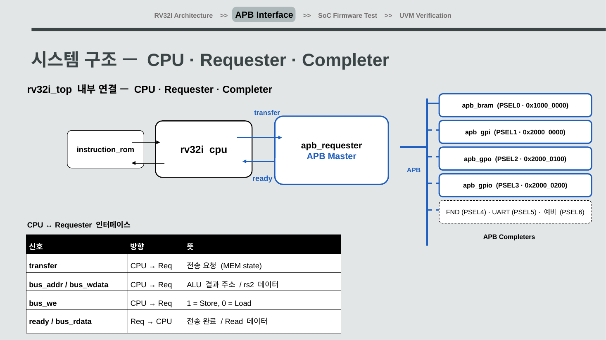
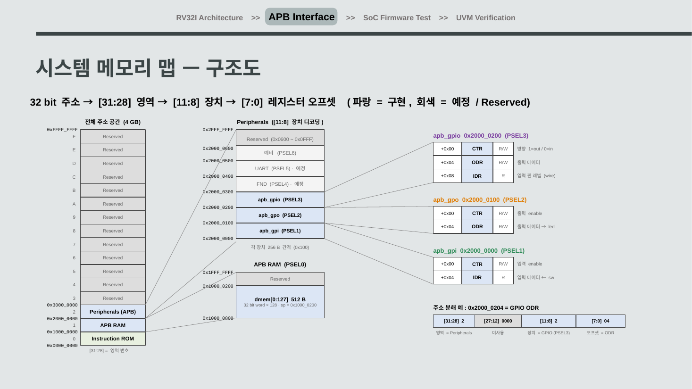
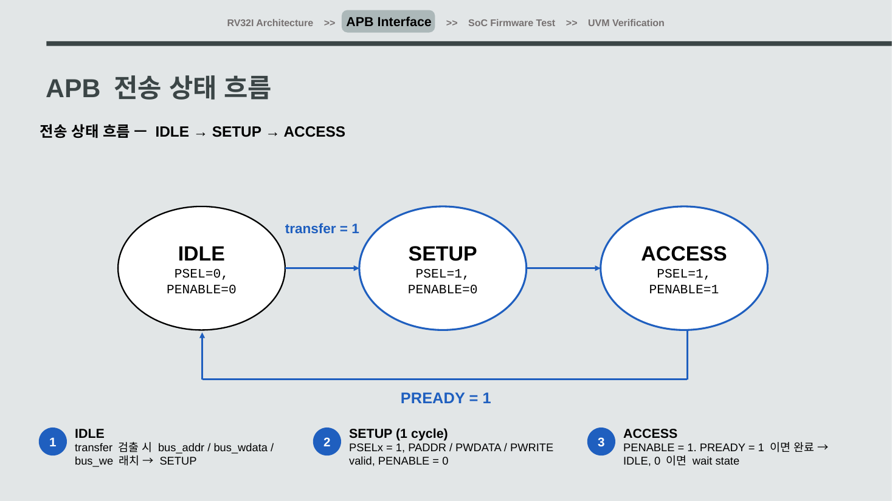
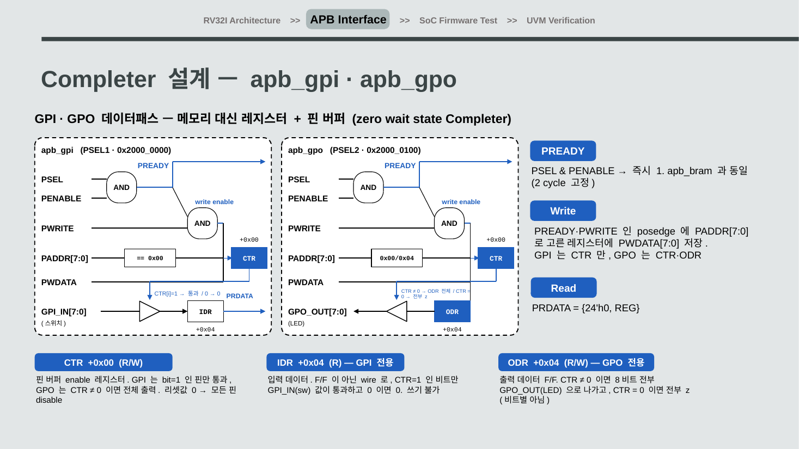
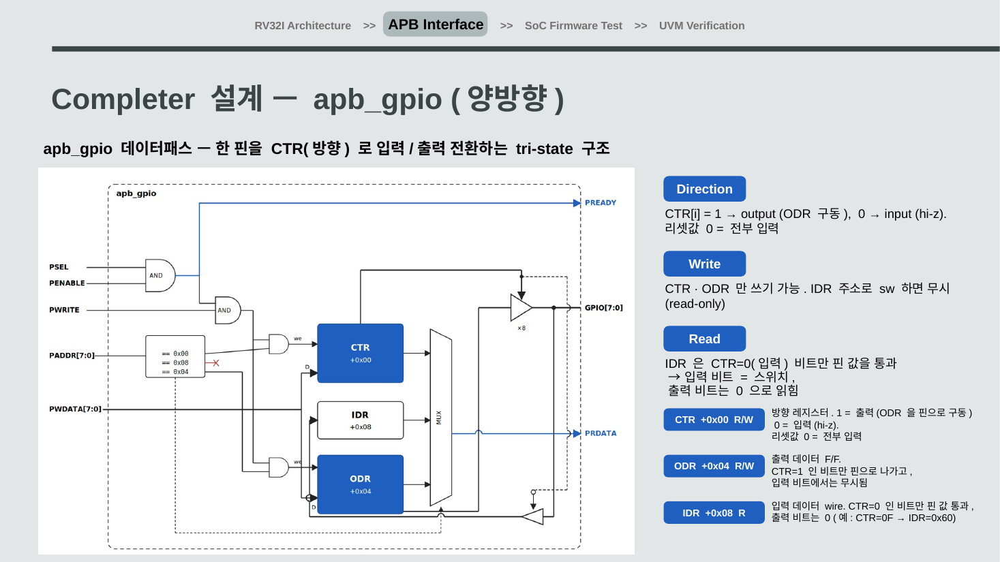
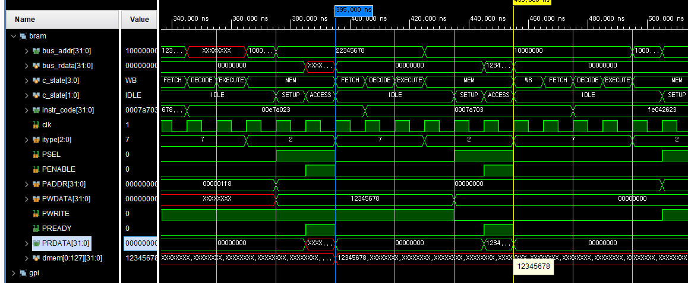
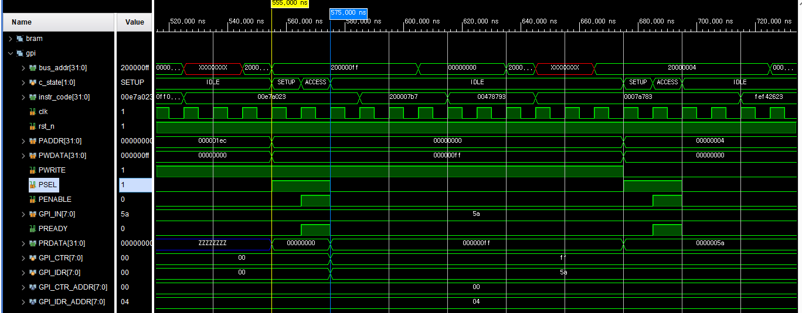
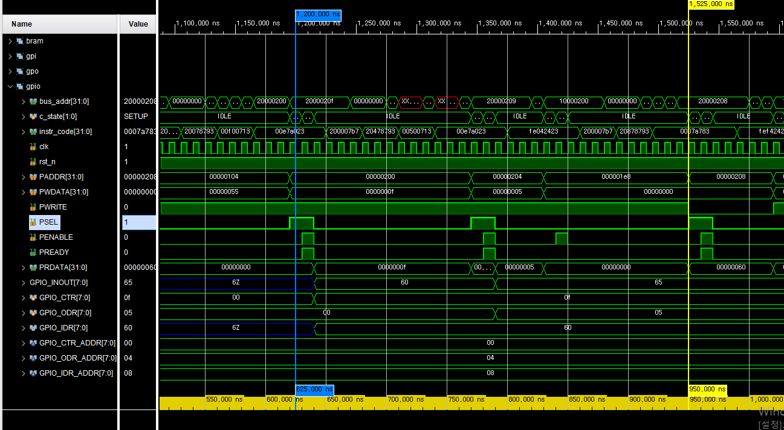

# AMBA APB 버스 기반 RV32I Multi-Cycle SoC

팀에서 직접 설계한 RISC-V(RV32I) Multi-Cycle CPU에 **AMBA APB 버스**를 붙여, 펌웨어의 `lw` · `sw` 명령만으로 RAM과 GPIO를 제어하는 SoC입니다.
4인 팀 프로젝트(AI 시스템 반도체 설계 1기 7조, 2026.09.11 ~ 09.16) 중 **APB Interface(Requester · Completer 4종 · 메모리 맵)** 를 맡았습니다.

| 항목 | 내용 |
| --- | --- |
| 내 담당 | APB Requester(Master) FSM · 주소 디코더 · 응답 MUX, Completer 4종(BRAM · GPI · GPO · GPIO), 메모리 맵, 파형 검증 |
| APB 전송 | SETUP → ACCESS 2 cycle, zero wait state |
| 주변장치 | BRAM 512B, GPI 8bit, GPO 8bit, 양방향 GPIO 8bit (확장 슬롯 3개 예약) |
| 검증 결과 | 펌웨어 시나리오 BRAM · GPI · GPO · GPIO 읽기/쓰기 **전 항목 기대값 일치** (Vivado 시뮬레이션) |
| 도구 | SystemVerilog, Vivado 2020.2 (xsim), Basys-3(타깃), Verilator(lint · 재검증) |

파일별 작성자는 [CONTRIBUTIONS.md](CONTRIBUTIONS.md)에 정리했습니다.

## 시스템 구조



- CPU는 MEM 단계에서 `transfer` · `bus_addr` · `bus_wdata` · `bus_we` 를 내보내고, `ready` 가 올 때까지 MEM 상태에 머뭅니다.
- `apb_requester` 가 이를 APB 신호로 바꾸고, 주소로 Completer 하나를 골라 그 응답만 CPU에 돌려줍니다.
- `PADDR` · `PWDATA` · `PWRITE` · `PENABLE` 은 모든 Completer가 공유하고, `PSEL` · `PREADY` · `PRDATA` 만 장치마다 따로 연결했습니다.

## 메모리 맵



32비트 주소를 `[31:28]` 영역 → `[11:8]` 장치 → `[7:0]` 레지스터 오프셋 순서로 2단계 디코딩합니다.

| 시작 주소 | 장치 | PSEL | 레지스터 (오프셋) | 상태 |
| --- | --- | --- | --- | --- |
| 0x1000_0000 | APB BRAM (512B) | PSEL0 | dmem[0:127] | 구현 |
| 0x2000_0000 | GPI | PSEL1 | CTR(+0x00) · IDR(+0x04) | 구현 |
| 0x2000_0100 | GPO | PSEL2 | CTR(+0x00) · ODR(+0x04) | 구현 |
| 0x2000_0200 | GPIO (양방향) | PSEL3 | CTR(+0x00) · ODR(+0x04) · IDR(+0x08) | 구현 |
| 0x2000_0300 ~ 0500 | FND · UART · 예비 | PSEL4 ~ 6 | — | 예약 |

## 설계

### APB Requester — `rtl/apb_requester.sv`



| 상태 | 동작 |
| --- | --- |
| IDLE | `transfer` 가 들어오면 주소 · 데이터 · 쓰기 여부를 레지스터에 래치 → SETUP |
| SETUP | 주소 디코더를 켜서 `PSELx = 1`, `PENABLE = 0` → ACCESS |
| ACCESS | `PENABLE = 1`. 선택된 Completer의 `PREADY = 1` 이면 IDLE, 0이면 대기(wait state) |

- `address_decoder`: `PADDR[31:28]` 로 RAM/주변장치 영역을, `PADDR[11:8]` 로 장치를 골라 `PSEL0~6` 과 `mux_sel` 을 만듭니다.
- `apb_mux`: `mux_sel` 로 해당 Completer의 `PRDATA` · `PREADY` 만 CPU의 `bus_rdata` · `ready` 로 연결합니다.
- 결과적으로 store는 6 cycle(FETCH · DECODE · EXECUTE · MEM × 3), load는 WB를 더해 7 cycle에 끝납니다.

### Completer 4종 (zero wait state: `PREADY = PSEL & PENABLE`)

| 모듈 | 구조 | 동작 |
| --- | --- | --- |
| `apb_bram` (`rtl/apb_ram.sv`) | 32bit × 128 word | ACCESS에서 `PWRITE` 이고 SW 명령이면 기록, 읽기는 `dmem[PADDR[31:2]]` 조합 출력 |
| `apb_gpi` | CTR · IDR | CTR 비트가 1인 스위치 입력만 IDR로 통과 (IDR은 F/F이 아닌 wire) |
| `apb_gpo` | CTR · ODR | CTR ≠ 0 이면 ODR을 LED로 출력, 0이면 전체 hi-z |
| `apb_gpio` | CTR · ODR · IDR | CTR 비트별 방향 설정(1 = 출력, 0 = 입력)하는 tri-state 양방향 포트. 입력 비트만 IDR로 읽힘 |

| GPI · GPO | GPIO |
| --- | --- |
|  |  |

## 검증

### 테스트 시나리오 — `sim/gpio_rom_code.txt`
C로 작성한 테스트 펌웨어를 RISC-V GCC로 빌드해 ROM에 넣었습니다 (`sim/rom_code_apb_gpio.mem`). 테스트벤치는 스위치 입력 `sw = 0x65A` 를 줍니다.

1. BRAM 0x1000_0000에 0x12345678을 쓰고 다시 읽기
2. GPI CTR = 0xFF 로 입력을 열고 IDR 읽기 → 스위치 `sw[7:0]` 값이 보여야 함
3. GPO CTR = 0xFF, ODR = 0x55 쓰기 → LED `led[7:0]` 출력
4. GPIO CTR = 0x0F(하위 4핀 출력, 상위 4핀 입력), ODR = 0x05 쓰기, IDR 읽기

### 결과

| 항목 | 기대값 | 결과 | 파형 |
| --- | --- | --- | --- |
| BRAM write → read | 0x12345678 | 0x12345678 |  |
| GPI IDR (CTR = 0xFF) | sw[7:0] = 0x5A | 0x5A |  |
| GPO 출력 (ODR = 0x55) | led[7:0] = 0x55 | 0x55 |  |
| GPIO 핀 (CTR = 0x0F, ODR = 0x05) | 하위 출력 5, 상위 입력 6 → 0x65 | 0x65 |  |
| GPIO IDR | 입력 비트만 통과 → 0x60 | 0x60 | 〃 |
| 스택 저장 (GPI · GPIO 값을 지역 변수에 저장) | dmem[123] = 0x5A, dmem[122] = 0x60 | 일치 | — |

같은 소스로 Verilator 재시뮬레이션에서도 모든 APB 트랜잭션 값이 동일하게 재현됐습니다. 파형 이미지는 클릭하면 크게 볼 수 있습니다.

## 실행 방법 (Vivado)

1. 새 RTL 프로젝트(Basys-3, xc7a35tcpg236-1)를 만들고 `rtl/` 의 모든 파일을 Design Source로 추가합니다. `rtl/pkg/rv32i_pkg.sv` 가 먼저 컴파일되도록 둡니다.
2. `sim/tb_rv32i_apb.sv` 와 `sim/rom_code_apb_gpio.mem` 을 Simulation Source로 추가하고, top을 `tb_rv32i_apb` 로 지정합니다.
3. Run Behavioral Simulation (테스트벤치가 3 µs 뒤 종료).

`constraints/Basys-3-Master.xdc` 는 보드 핀 배치용입니다. 아래 한계 1번 때문에 현재 설계는 보드에서 검증하지 않았습니다.

## 폴더 구조

```
rtl/          RV32I CPU + APB Requester + Completer 4종 (top: rv32i_top in rv32i_cpu.sv)
sim/          테스트벤치, 테스트 펌웨어(.mem), 펌웨어 디스어셈블
constraints/  Basys-3 핀 배치
docs/img/     구조도, 파형 캡처
```

## 팀

| 이름 | 담당 |
| --- | --- |
| 문준석 | RV32I Multi-Cycle 코어 (Datapath · Control Unit) |
| **김진환** | **APB Interface (Requester · Completer · 메모리 맵)** |
| 김서연 | Top 통합 · 펌웨어 테스트 |
| 홍성은 | UVM 검증 (VCS · Verdi) |

팀 통합 결과: 0 ~ 10 누적합을 계산해 BRAM에 저장하는 펌웨어 테스트를 통과했고, UVM 테스트벤치로 R/I-type 명령어 검증 Overall 커버리지 100%(1,000 cycle)를 달성했습니다 (팀 발표 자료 기준).

## 한계 및 개선 방향

현재 설계는 **Vivado 행위 시뮬레이션 기준으로 검증**했습니다 (BRAM · GPI · GPO · GPIO 읽기/쓰기 값 모두 기대값과 일치).
GPIO를 추가한 최종 설계로는 FPGA 비트스트림을 다시 만들어 보드에서 확인하지 않았습니다.
코드 검토와 Verilator lint에서 확인한 한계와 개선 방향은 다음과 같습니다.

| 구분 | 현재 상태 | 영향 | 개선 방향 |
| --- | --- | --- | --- |
| GPIO 핀 연결 | `apb_gpio`의 양방향 포트를 최상위 **입력** 포트 `sw[11:8]`에 연결 | 시뮬레이션에서는 동작하지만, 입력 핀을 구동하는 구조라 FPGA에서는 출력 방향으로 쓸 수 없음 (Verilator는 오류로 처리) | 최상위에 별도 `inout` 포트(예: Pmod JA)를 두고 xdc에 연결 |
| 미매핑 주소 응답 | FND·UART용 PSEL4~6의 PREADY/PRDATA가 연결되지 않았고, 정의되지 않은 주소에는 응답하는 Completer가 없음 | 해당 주소에 접근하면 ready가 오지 않아 CPU가 MEM 상태에서 멈춤 | 미매핑 주소에 기본 Completer(PREADY=1, PRDATA=0)를 두거나 PSLVERR 응답 추가 |
| 바이트 · 하프워드 접근 | BRAM은 SW(funct3=010)만 저장, SB/SH는 무시. LB/LH는 워드 전체를 반환 | C 코드에서 char/short 접근 시 잘못된 결과 | PADDR[1:0]과 funct3로 바이트 레인(PSTRB) 선택, 로드 데이터 부호 확장 추가 |
| BRAM 주소 범위 | 128워드 메모리를 PADDR[31:2]로 인덱싱, 범위 검사 없음 | 0x1000_0200 이상 주소는 앞쪽 주소와 겹치거나 X | 범위 밖 접근을 PSLVERR로 처리하거나 인덱스를 [8:2]로 제한 |
| Completer 일관성 | 미정의 레지스터 읽기 시 GPI·GPO는 `z`, GPIO는 `0` 반환. 리셋도 GPIO만 비동기 | 동작에는 문제없으나 합성 경고, 코드 일관성 부족 | 모든 Completer의 기본 응답을 `0`, 리셋 방식을 하나로 통일 |
| 테스트벤치 | VCS 파형 덤프 문장이 존재하지 않는 모듈명(`tb_rv32i_cpu`)을 가리킴. 결과 판정을 파형 눈확인에 의존 | VCS에서 덤프 실패, 회귀 테스트 불가 | 모듈명 수정, 기대값을 비교하는 self-checking 테스트벤치로 전환 |

참고: `docs/img`의 GPI · GPO · GPIO 파형은 ROM 코드에 BRAM 읽기 명령(lw)이 추가되기 전에 캡처되어, 현재 코드로 시뮬레이션하면 같은 값이 약 70ns(7클럭) 늦게 나타납니다.
